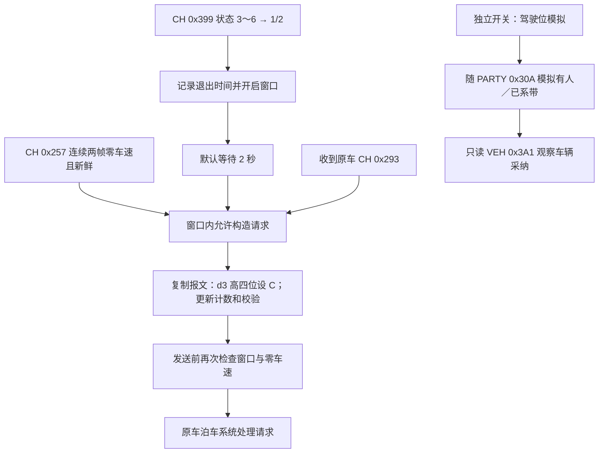

# Albert P1.6.4：离车泊车相关实现

分析对象：`Albert-P4-P1.6.4-V3.2-4d97f369`。以下结论来自原网页、反编译和 RISC-V 指令复核，未连接车辆、发送 CAN 或烧录固件。函数名和 C 代码中的语义名称由分析者命名。

**已定位的实现是两条独立 CAN 路径：退出 FSD 后请求原车开始泊车，以及模拟主驾驶有人／安全带已系。** 当前路径中，ESP32 修改原车状态与请求报文；未发现由这条路径自行规划泊车轨迹或直接控制转向、制动的实现。原车能否在驾驶员离开、开门后继续并完成泊车，不能仅凭这些请求字段确定。

原网页没有单独命名“离车泊车”的控制项，对应的两个开关是“自动激活泊车”和“驾驶位有人与安全带模拟”。两者默认关闭，没有找到开关之间的自动联动。隐藏的“增强 AP / 智能召唤”是另一项配置，不能据此认定完整召唤流程已恢复。



## 1. 网页配置与后端入口

| 参数 | 默认／范围 | 含义 |
|---|---|---|
| `v13SpaceToSpaceEnabled` | 关闭 | 退出 FSD 后自动请求泊车 |
| `v13ParkingDelayMs` | 2000 ms；0～10000 ms | 从退出边沿开始等待 |
| `v13ParkingDurationMs` | 30000 ms；1000～60000 ms | 延迟结束后的请求窗口长度 |
| `fsdDriverOccupiedSpoofEnabled` | 关闭 | 独立的有人与安全带模拟 |

原网页说明直接写明：`0x399` 从 3～6 变为 1/2 后等待延迟，只有 CH `0x257` 确认零车速才随原车 `0x293` 发送“开始泊车”；移动时暂停发送，倒计时继续，到时恢复原车值。见 [HTML L502](../recovered_web/dashboard.html#L502) 和 [驾驶位模拟 L714](../recovered_web/dashboard.html#L714)。

配置经 `POST /config` 的 [0x48101F34](../decompiled/functions/48101f34_recovered_http_post_config_48101f34.c) 解析。序列化函数 [0x4808F6E8](../decompiled/functions/4808f6e8_FUN_ram_4808f6e8.c) 确认配置结构内：`+0x89` 为驾驶位模拟，`+0x8F` 为泊车开关，`+0x90/+0x92` 为两个 u16 毫秒值。运行配置快照位于 device `+0xB38`，泊车开关／延迟／持续时间对应 device `+0xBC7/+0xBC8/+0xBCA`。

尽管参数名保留 `v13`，已检查的触发器、构造器、发送前复检和 `updateV13SpaceToSpaceUi()` 均没有显式 `protocol == 13` 门控；该 JS 只按泊车开关显隐延迟和持续时间。旧文档“非 V13 隐藏”应修正。**这不等于已证明所有协议或车型兼容。**

## 2. 报文、字段和时限

`d[0]…d[7]` 为 payload 的零基字节号。此处 Frame 对象的 ID 在 `+0`，DLC 在 `+4`，payload 在 `+5…+12`，bus mask 在 `+13`，来源微秒时间在 `+16`。反编译中的 `param_2[2]` 是 32 位对象成员，不能直接当成 `d[2]`。

| 线路 | ID / DLC / MUX | 方向 | 字段及用途 | 新鲜度／连续性 |
|---|---|---|---|---|
| CH / CAN0 / mask 1 | `0x399` / 正常帧 8，无本路径 MUX 筛选 | RX | `d[0]&0x0F`，前值 3～6、后值 1/2 时触发 | 两次状态观察间隔 ≤1500 ms；构造与发送前要求最新状态 ≤1500 ms |
| CH / CAN0 / mask 1 | `0x257` / 8，无 MUX 筛选 | RX | `raw=(d[6]<<5)\|(d[5]>>3)`；`raw==500` 为零车速 | 连续 2 帧；相邻间隔 ≤100 ms；发送时最新值 ≤100 ms |
| CH / CAN0 / mask 1 | `0x293` / 8，无 MUX 筛选 | RX→TX | `d[3]` 高 4 bit 设 `0xC`；`d[6]` 高 4 bit 计数加 1；`d[7]` 重算 | 随原车来源帧构造；提交截止为来源时间 +20000 µs |
| PARTY / CAN2 / mask 4 | `0x30A` / 8，无 MUX 筛选 | RX→TX | `d[0]` 低 3 bit 设 1；bit 3～4 设 1；计数和校验更新 | 来源校验必须通过；跟随来源计数；提交截止为来源时间 +5000 µs |
| VEH / CAN1 / mask 2 | `0x3A1` / 8 / `d[6]&0x0F==2` | RX | `d[0]` bit7 为占用；`d[3]` bit6 为 1 且 `d[4]` bit0 为 0 表示带状态满足 | 校验通过；两次连续满足；观察年龄和相邻间隔 ≤300 ms |

三路均 500 kbit/s。原网页的连接器标签分别为 CH 13/14、VEH 9/10、PARTY 2/3；这些标签尚未做实物线束校准。

`0x257` 的其他路径存在速度转换，但本功能直接比较 raw 500；不需要猜测其物理比例。非 500 值，包括一般速度路径的无效码 `0x1FFF`，均不能满足本泊车零车速门控。

## 3. 泊车请求状态机

### 3.1 从退出边沿开启窗口

CH `0x399` 由观察器 [0x480DA2A8](../decompiled/functions/480da2a8_FUN_ram_480da2a8.c) 调入 [0x480D8F08](../decompiled/functions/480d8f08_FUN_ram_480d8f08.c)。后者维护前一状态、已观察标志、退出时间和 armed 标志。

- 要求 `fsdEnabled`、`v13SpaceToSpaceEnabled`、`canCommsEnabled` 和 CH TX 开关有效。
- 状态低四位从 3～6 进入 1/2，记录退出时间并置 armed。
- 前一次状态观察距本次超过 1500 ms，则清除前值和 armed，避免跨长间隔识别退出边沿。
- 后续状态保持 1/2 时窗口继续；离开 1/2 则取消 armed。
- 本分支未按“驾驶员接管”“开门”“安全带解开”等原因进一步分类，也没有局部挡位 P、座椅、车门条件。

原网页 JS 的 `autoShiftAp()` 已给出名称：`0 DISABLED / 1 UNAVAILABLE / 2 AVAILABLE / 3 ACTIVE_NOMINAL / 4 ACTIVE_RESTRICTED / 5 ACTIVE_NAV / 6 ACTIVE_FSD`（[JS L362](../recovered_web/dashboard.script0.js#L362)）。因此这条边沿实际覆盖 3～6 的 AP/FSD 活跃状态进入不可用／可用状态，不含变为 `0 DISABLED`。这些是该固件网页采用的枚举名，尚未独立对照厂家 DBC。

**校验边界需单独说明：** `0x399` 处理器确实计算 `0x9C + sum(d[0..6])`，供其他有效性与模板分支使用；但泊车边沿更新在校验失败分支也可到达。机器码路径为 `0x480D8FF8 → 0x480D9348…0x480D938E → 0x480D9390`，DLC 非 8 的分支也可进入这一局部路径。因此不能给本边沿逻辑补写“DLC=8 且 checksum 合格”的严格门控。正常 `0x399` 帧为 8 字节；更上游接收过滤的全部行为未在此报告中恢复。

### 3.2 两帧零车速确认

`0x480DA2A8` 在 CH `0x257` 上更新单独的泊车速度缓存。新鲜连续两帧 raw 500 才达到确认数 2；DLC 不符或非零车速会使确认失效，间隔超过 100 ms 则重新从第一帧累计。

已确认静止后又收到非零车速／无效 DLC，会调用 `0x4805932A(device, 0x13)` 撤销泊车 stream 19。信号过期时构造器和发送前复检拒绝请求。这里清除的是请求发送许可，退出窗口的计时不因移动暂停。

### 3.3 修改原车 0x293

构造函数 [0x480C76A2](../decompiled/functions/480c76a2_FUN_ram_480c76a2.c) 要求：

1. 四个配置门控有效。
2. 仍 armed，最新 `0x399` 状态为 1/2 且年龄 ≤1500 ms。
3. `delay <= now-exit_time < delay+duration`。
4. 零车速确认数 ≥2，最新 `0x257` 年龄 ≤100 ms。
5. 本次来源为 CH `0x293`、DLC 8。

若来源 `d[3]` 高四位已经为 `0xC`，跳过重复覆盖。否则复制整个来源对象，只修改以下 payload 字段：

```c
out = src;
out.d[3] = (src.d[3] & 0x0F) | 0xC0;
out.d[6] = (src.d[6] & 0x0F)
         | (((src.d[6] & 0xF0) + 0x10) & 0xF0);
out.d[7] = (0x95 + sum(out.d[0..6])) & 0xFF;
```

高四位计数模 16 递增，低四位保留。校验 seed `0x95` 等于 ID 两字节 `0x02+0x93`。构造器没有局部检查来源 `0x293` 的校验字节，输出校验使用修改后的内容重新计算。

请求交给共用 `0x4805CB5E`，截止为来源时间 +20000 µs，来源时间缺失时采用当前微秒时间。流分类器 [0x480409AE](../decompiled/functions/480409ae_FUN_ram_480409ae.c) 把 CH `0x293` DLC 8 归为 stream `0x13`。这是接收原车报文后跟随构造，未发现此路径使用固定周期重放常量 payload。

### 3.4 发送前再次检查

共用验证器 [0x480C6318](../decompiled/functions/480c6318_FUN_ram_480c6318.c) 的 stream `0x13` 分支独立检查：配置、状态 1/2、`0x399` 新鲜度、armed、延迟／持续时间、连续零车速次数和速度年龄。前置通用检查还包括通信、线路 TX、传输许可、owner／generation。

因此，在入队后车辆开始移动、来源过期或窗口到期时，排队请求也会被拒绝，不能只依据构造时通过门控判断最终发送。

### 3.5 默认时间线与退出

以退出边沿为 t=0，默认 t=2 秒开始进入请求窗口，t=32 秒窗口结束。期间只有静止且来源新鲜时才覆盖 `0x293`。例如 t=10～15 秒车在移动，这 5 秒停止覆盖，窗口仍在 t=32 秒结束。

到期或状态失效后的恢复方式是停止注入修改后的帧，后续继续使用原车值；本路径没有找到另发专用“取消泊车”payload 的代码。故“请求窗口到期”不能解释为“原车必定在此时结束泊车”。

## 4. 驾驶位有人与安全带模拟

### 4.1 独立跟随 PARTY 0x30A

构造器 [0x480CB95C](../decompiled/functions/480cb95c_FUN_ram_480cb95c.c) 要求 PARTY `0x30A` DLC 8，来源校验为：

```c
src.d[7] == ((0x0D + sum(src.d[0..6])) & 0xFF)
```

来源占用值是 `d[0]&7`，安全带值是 `(d[0]>>3)&3`，滚动计数是 `d[6]>>4`。配置门控为驾驶位模拟开关、通信、PARTY TX 和 `0x48045922(...,4,0)` 传输许可。**构造器不局部要求 FSD 总开关、FSD 正在运行、泊车窗口、零车速或关门。** 通用传输许可仍会检查驱动运行状态，不能把无局部门控理解成无条件发送。

若来源已经“有人=1 且安全带=1”，跳过覆盖；来源计数重复也跳过。存在 pending 时不再提交，等待终态超过 40 ms 的旧状态会被清理。

```c
out = src;
out.d[0] = (src.d[0] & 0xE0) | 0x09; // 低3bit=1；bit3..4=1
out.d[6] = (src.d[6] & 0x0F)
         | (((src.d[6] & 0xF0) + 0x10) & 0xF0);
out.d[7] = (0x0D + sum(out.d[0..6])) & 0xFF;
```

高三位及其余未指定字段保留。seed `0x0D` 是 ID 两字节 `0x03+0x0A`。提交截止为来源时间 +5000 µs，缺失来源时间时取当前微秒时间。此报文归为 stream 8；提交 owner 参数为 11，token 类别参数为 10，这三个编号不可混为同一个事件编号。

### 4.2 只读 0x3A1 检查车辆采纳

观察器 [0x480CCF42](../decompiled/functions/480ccf42_FUN_ram_480ccf42.c) 读取 VEH `0x3A1`，限定 DLC 8、`d[6]&0x0F==2`，校验 seed `0xC0`：

```c
occupied = (d[0] >> 7) == 1;
belt_ok  = (d[3] & 0x40) != 0 && (d[4] & 0x01) == 0;
```

两次连续观察同时满足且新鲜，累积采纳确认计数。它没有在这条路径修改 `0x3A1`。这确认的是车辆反馈状态符合目标；单凭此值不能区分真实传感器状态与模拟导致的状态。

提交回执 [0x480DB9D4](../decompiled/functions/480db9d4_FUN_ram_480db9d4.c) 处理 token 类别 10；终态处理 [0x480DF834](../decompiled/functions/480df834_FUN_ram_480df834.c) 的事件 11 更新内部 TX 标志与统计。**需修正早期解释：内部 TX 标志与网页公布的 Active 不是同一个判定。**

[0x4805ABF4 L899](../decompiled/functions/4805abf4_FUN_ram_4805abf4.c#L899) 构造公开状态时还要求：开关启用、内部 TX 成功标志、最近成功发送时间非零且年龄 ≤300 ms、最近 `0x3A1` 反馈时间非零且年龄 ≤300 ms、连续满足次数 ≥2。

```c
published_active = cfg.fsdDriverOccupiedSpoofEnabled && tx_ok_flag
    && last_tx_ms != 0 && elapsed(now_ms, last_tx_ms) <= 300
    && feedback_ms != 0 && elapsed(now_ms, feedback_ms) <= 300
    && feedback_confirm_count >= 2;
```

字段映射为 device `+0x9094/+0x9095/+0x9098/+0x90A4` → 计算 `+0x1D83` → 复制到 `+0x1987`。设备基址 `0x4FF60E20`，公开快照起点 `0x4FF61A00=device+0xBE0`；差值 `0x1987-0xBE0=0xDA7`。两个序列化器从同一快照取偏移 `0xDA7`，分别输出 `driverSeatSpoofActive`（[0x480BE2BE L592](../decompiled/functions/480be2be_FUN_ram_480be2be.c#L592)）和 `driverOccupiedSpoofActive`（[0x4806851C L402](../decompiled/functions/4806851c_recovered_http_get_runtime_status_4806851c.c#L402)）。基址另由 `0x4810D032→0x4810CA34` 调用机器码确认。

所以公开 Active 表示近期发送成功与目标反馈同时成立，仍不证明反馈由模拟造成，也不表示泊车开始或完成。快照更新限频约 100 ms，接口读取的是发布时的状态，不能把网页更新时间当成报文采样时间。未找到泊车 stream19 消费这份采纳计数的分支。

### 4.3 自动换挡读取修改前的输入缓存

`0x480CCF42` 先缓存收到的 PARTY `0x30A` 的占用、安全带和连续确认次数，再调用模拟构造器。换挡检查 [0x48105658](../decompiled/functions/48105658_FUN_ram_48105658.c) 使用这份输入缓存（有效性、≤300 ms、值为 1、确认数 ≥2）；本地构造 `out.d0=...|09` 不会回写它。尚未证明所有接收路径都会排除物理总线上重新收到的自身输出，因此“缓存来自修改前的输入”不能扩大成“始终是真实传感器值”，见 §8.4。

## 5. C 风格流程重建

以下仅重建所查逻辑，省略锁、原子引用、日志和其他功能分支；不是可编译固件。尤其不人为给 `0x399` 边沿加入严格来源校验条件。

```c
bool parking_enabled(void) {
    return cfg.fsdEnabled && cfg.v13SpaceToSpaceEnabled
        && cfg.canCommsEnabled && cfg.can0TxEnabled;
}

void observe_399_state(uint8_t state, uint32_t rx_ms) {
    if (!parking_enabled()) { reset_parking_observation(); return; }
    bool continuous = !seen399 || elapsed(rx_ms, last399_ms) <= 1500;
    if (!continuous) { previous399 = 0x0F; armed = false; }
    if (state == 1 || state == 2) {
        if (continuous && previous399 >= 3 && previous399 <= 6) {
            exit_ms = rx_ms;
            armed = true;
        }
    } else {
        armed = false;
    }
    previous399 = state; last399_ms = rx_ms; seen399 = true;
}

bool parking_request_allowed(uint32_t now_ms) {
    uint32_t dt = elapsed(now_ms, exit_ms);
    return parking_enabled() && armed && seen399
        && (previous399 == 1 || previous399 == 2)
        && elapsed(now_ms, last399_ms) <= 1500
        && dt >= clamp_delay(cfg.v13ParkingDelayMs)
        && dt < clamp_delay(cfg.v13ParkingDelayMs)
              + clamp_duration(cfg.v13ParkingDurationMs)
        && speed_seen && zero_speed_count >= 2
        && elapsed(now_ms, speed_ms) <= 100;
}

void on_ch_293(Frame src, uint32_t now_ms, uint32_t now_us) {
    if (src.dlc != 8 || !parking_request_allowed(now_ms)) return;
    if ((src.d[3] >> 4) == 0x0C) return;
    Frame out = make_293_request(src); // 字段公式见上文
    submit(out, deadline_from_source_or_now(src, now_us) + 20000);
    // stream19 真正发送前再调用同等状态门控和通用许可检查。
}

void on_party_30a(Frame src, uint32_t now_us) {
    remember_received_occupied_and_belt(src); // 修改前的输入；自动换挡使用
    if (!cfg.fsdDriverOccupiedSpoofEnabled || !cfg.canCommsEnabled
        || !cfg.can2TxEnabled || !transport_permitted(PARTY)) return;
    if (src.dlc != 8 || !checksum_30a_ok(src)) return;
    if (pending) return;
    settle_expired_terminal_wait_over_40ms();
    if ((src.d[0]&7) == 1 && ((src.d[0]>>3)&3) == 1) return;
    if (duplicate_source_counter(src)) return;
    Frame out = make_30a_spoof(src); // 字段公式见上文
    submit(out, deadline_from_source_or_now(src, now_us) + 5000);
}
```

## 6. 证据地址与机器码复核

| 逻辑 | 函数／重点指令地址 |
|---|---|
| 399 退出边沿、连续性 | `0x480D8F08`；`0x480D9390…0x480D93DA`、`0x480D98CA…0x480D98F0` |
| 399 校验失败仍可更新边沿 | `0x480D8FF8…0x480D903E`、`0x480D9348…0x480D9390`、`0x480D9530` 校验分支 |
| 257 两帧静止、撤销 stream19 | `0x480DA2A8`；`0x480DABE8…0x480DAC80`、`0x480DA8D4…0x480DA8EA` |
| 293 字段、计数、校验、截止 | `0x480C76A2`；`0x480C773E…0x480C7922`；关键写指令 `0x480C78B8/0x480C78BC/0x480C78EC` |
| stream19 发送前复检 | `0x480C6318`；`0x480C6698…0x480C676A` |
| 30A 校验与原始字段 | `0x480CB95C`；`0x480CBC62…0x480CBCA2` |
| 30A 模拟、计数、校验、截止 | `0x480CBB6A…0x480CBBF0`；关键写指令 `0x480CBB88/0x480CBB8C/0x480CBBAE` |
| 3A1 反馈／原始30A缓存 | `0x480CCF42`，反编译 L131／L507 |
| 提交／终态／输入带门控 | `0x480DB9D4`、`0x480DF834`、`0x48105658` |
| 公开 Active 的组合判定与发布 | `0x4805ABF4`；`0x4805B53C…0x4805B5BE`、`0x4805BA7C…0x4805BABC` |
| 门状态与迎宾状态机 | `0x480422D8`、`0x4804220C`、`0x48042BB2` |
| P 出发完成计数 | `0x481062C4`；`0x48106534…0x48106546`、`0x481071D8…0x48107218` |
| 增强 AP 字段覆盖 | `0x4809EC88→0x4FF230E8→0x4FF232BE`；`0x4FF23708…0x4FF23724` |

保存的[指令摘录](exit_parking.machine_evidence.txt)与[来源核对记录](exit_parking.validation.json)将摘录中的 RISC-V 指令字节按 manifest 映射回 bootstrap 和提取应用逐条比对。此检查证明摘录来自对应镜像，不自动证明每项语义解释或实车执行效果。

镜像映射：`bootstrap_offset = application_offset + segment.image_offset + (VA - segment.address)`。

- bootstrap SHA256：`11cd02e1d0bcda1cd894a249e963ac54eb67f6cd29ab6d40bcaf85fff8711343`
- application SHA256：`4948504e382ff56fb3cb05ae53688fb5261b96984e17877c83ed1596b5ffd9fa`

## 7. 仍需确认的离车行为

在这两条已定位路径中，没有找到以开门／离座作为泊车触发，也没有找到“车门已关”的覆盖。其触发依据是 `0x399` 状态边沿；驾驶位模拟只改有人与安全带字段。

尚未确认原车如何结合门锁、车门、摄像头、远程钥匙、泊车可用状态和其他控制器信号决定是否允许离车继续泊车；也未定位这条功能的完整“泊车完成”反馈。当前可以确定请求如何生成与何时停止，不能将它表述为已验证的完整无人泊车方案。

## 8. 后续复核：已收敛的疑点和剩余边界

### 8.1 找到门／空座解析，但属于迎宾灯输入

[0x480422D8](../decompiled/functions/480422d8_FUN_ram_480422d8.c) 解析 VEH 的 `0x102/0x103/0x3C2/0x31A`。调用链为 `0x48109D5A→0x480CCF42→0x48042BB2(device+0xB8,...)→0x480422D8(device+0xF0,...)`。反编译器把 `0x48042BB2` 的后续参数漏出，但调用点和机器码确认还传入传输 generation 与当前时间。

解析器要求 VEH、DLC8、来源时间有效、接收年龄 ≤500 ms、generation 非零，以及对象 `+0x1B==0 / +0x1C==0`。这两个是对象元数据条件，不是 payload 校验；本解析器没有另做求和校验。

| 输入 | 字段 | 对应缓存／解释 |
|---|---|---|
| VEH `0x102` | `((d1>>6)\|(d2<<2))&0xF` | 门索引0；网页迎宾数组称左前门 |
| VEH `0x103` | 同上 | 门索引1；网页称右前门 |
| VEH `0x102` | `(d2>>2)&0xF` | 门索引2；网页称左后门 |
| VEH `0x103` | 同上 | 门索引3；网页称右后门 |
| VEH `0x3C2` MUX0：`d0&3==0` | `(d6>>2)&3` | 左前座椅输入：raw1生成有效空座标志，raw2有效但非空；0/3无效 |
| VEH `0x3C2` MUX0 | `d7&3`、`(d7>>2)&3` | 后排两项同类有效／空座标志；这里只记录固件实际谓词 |
| VEH `0x31A` | `(d0&6)==0`、`(d0&7)==0` | 另一座椅项的有效／空座谓词；未借用为驾驶位30A字段 |

门名来源是 [JS L800](../recovered_web/dashboard.script0.js#L800) 的 `welcomeDoors=[左前、右前、左后、右后]`，不来自此前通用 `autoShiftDriverDoorStatus` 格式化代码。

[0x4804220C](../decompiled/functions/4804220c_FUN_ram_4804220c.c) 将 raw2 作为关闭，累计至2；raw1/5 作为打开，在先前已有至少两次关闭且之前未打开时产生开门边沿；raw3/4保留历史门状态并更新时间，0或≥6清无效。相邻来源间隔超过500 ms清历史确认。

[0x48042BB2](../decompiled/functions/48042bb2_FUN_ram_48042bb2.c) 消费开门边沿；迎宾模式0还要求对应空座标志有效、新鲜且为空，模式1放宽空座条件。这些缓存位于 device `+0xF0…+0x130`，泊车状态位于 `+0x7CB8…+0x7CC8`。已检查的399边沿、293构造、stream19最终验证及30A模拟没有读取这组迎宾门缓存，也没有构造102/103来伪装关门。**这说明固件这两条路径不以离座／开门为触发；原车控制器仍可能自行根据门状态拒绝或中断泊车。**

### 8.2 “P 出发已完成”实际等待重新进入 FSD

原网页 `renderFsdParkStartStatus()` 的“已完成／已中止／未完成”对应 `fsdParkLaunchState`，与退出后 stream19 请求是两个状态机。实际完成分支位于 [0x481062C4 L698](../decompiled/functions/481062c4_FUN_ram_481062c4.c#L698)，不能只凭函数名含 park 或网页“已完成”认作泊车完成：

```c
// P 出发流程已进入等待新399状态的阶段。
if (awaiting_new_399 && das_time_nonzero && das_age_ms <= 500
    && observed399_generation != generation_saved_at_wait
    && das_state == 6 /* ACTIVE_FSD */) {
    launch_state = 6; // 网页显示已完成
    launch_complete_count++;
    clear_launch_requests_and_399_spoof();
}
```

其中原399观察代数为 device `+0x7A4C`，DAS状态／时间为 `+0x7C58/+0x7C64`。完成计数内部在 `+0x7DA4`，写入发布字段 `+0x7DD4→+0x1D2C→+0x1468`，最终序列化为 `fsdParkLaunchCompleteCount`。状态值6在这里表示进入FSD，**没有检查293泊车任务到达目标车位、停车或回P**。P出发过程另有399低四位模拟为6的构造 `0x480D9A80`；其输出、自回波和原车反馈仍应分别记录。

### 8.3 增强 AP 开关的已确认输出范围

`enhancedAutopilotEnabled` 位于 cfg `+0x2B`。策略生成器 [0x4809EC88](../decompiled/functions/4809ec88_FUN_ram_4809ec88.c) 将它打包为 CH 策略word bit4、VEH策略word bit2，并分别受对应运行许可限制。[0x4FF230E8](../decompiled/functions/4ff230e8_FUN_ram_4ff230e8.c) 解包为 CH／VEH增强标志；[0x4FF232BE](../decompiled/functions/4ff232be_FUN_ram_4ff232be.c) 在 CH／VEH `0x3FD DLC8 MUX1` 上执行：

```c
if (lane_allowed && enhanced_ap_for_lane && (src.d0 & 7) == 1) {
    out.d2 &= 0xF7;
    if (protocol == 14) out.d5 |= 0x80;
}
```

这已证明具体覆盖位及配置到构造器的链路；这些位的厂家业务名称、是否只是能力／限制声明仍未独立确认。所追链路未给出召唤目标、路线或完成状态，不能从该开关名称推导完整手机召唤实现，也不能把它并入293自动泊车流程。

### 8.4 接收入口与自身回波：仍保留输入真实性边界

回调 `0x4810A7E4` 在通信运行条件下分派输入；CH399会被放入观测队列并继续送入 `0x48109D5A`。从该回调到399观察器的所查路径没有发现对399 payload校验的统一拒绝，也没有发现修复局部错误校验仍可更新泊车边沿的门控。`0x293`同样不能补写未知的上游checksum保证。这里不把CAN控制器链路层CRC等同于payload应用校验。

`0x48109D5A` 有针对VEH3C2近期输出的匹配剔除，但这不自动证明399和30A也受同一处理。30A输入缓存写入与构造器局部没有按对象`+0x18` bit8（其他来源分类使用的标记）拒绝；上游底层是否抑制自身发送回波、以及物理总线是否再次把输出作为RX输入，尚未完整追清。因此自动换挡的结论收窄为“使用构造前收到的30A缓存”，不保证其在所有运行条件下都只含真实传感器值。

### 8.5 目前仍需哪种证据

| 未确认问题 | 当前能确定的边界 | 需要继续查的证据 |
|---|---|---|
| 293请求是否被原车接受并进入泊车 | 固件能生成请求，3A1仅反映人／带状态 | 原车泊车状态RX及其ID/MUX/阶段定义；同步请求与状态时序 |
| 开门、解带、离座后是否继续 | 固件30A只改有人和带；未在已查路径覆盖门 | 原车门／锁／钥匙／泊车状态的关联与拒绝原因 |
| 泊车完成／失败／取消怎样判断 | 窗口到期只停止覆盖；P出发完成计数不适用 | 对应原车任务结束状态、实际挡位和制动状态，不仅TX成功 |
| 30A模拟是否污染“原始”带缓存 | 本地out不回写输入缓存 | TWAI接收自回波处理、来源标记写入点及RX/TX同步记录 |
| 增强AP是否足以支持召唤 | 3FD MUX1字段覆盖已确认 | 原车对这些位的语义、远程会话与召唤状态链 |
| 车型／版本兼容范围 | 此镜像的字段操作已确认 | 匹配车型软件版本、DBC或可信同步抓包 |

以上继续分析均为静态读文件；没有连接设备、发送CAN或烧录。新增指令片段也纳入来源字节比对，静态证据不替代车辆执行反馈。
