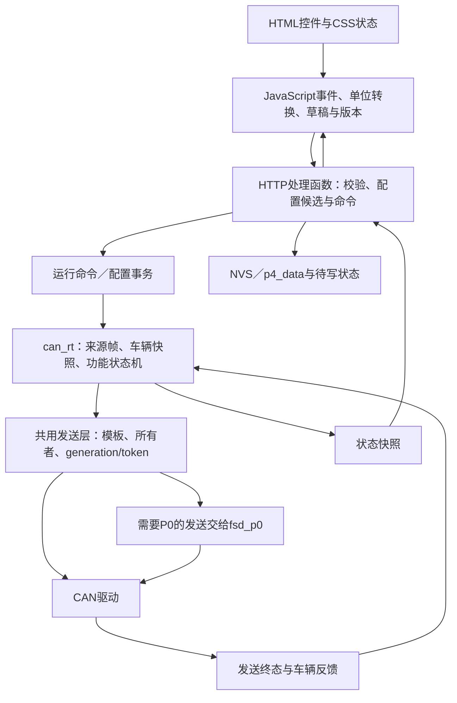

# Albert P4：从网页功能到 C 实现逻辑

已经按原始 HTML / CSS / JavaScript 整理为 **18 个模块、145 项功能及子功能**，逐项说明前端入口、HTTP 接口、C 处理地址、运行逻辑及 C 风格伪代码。全部 **87 条 HTTP 注册**均有归属；另提供 **437 行静态／模板控件**的覆盖清单。

145 是本次语义分组的数量，包含配置、动作、显示和内部协调机制，不是原项目的官方功能数。437 是语法提取行数，包含表单、链接和模板片段；循环生成的控件按模板分析，不代表运行页面只有437个控件。

直接阅读：[可搜索的功能分析页面](index.html) · [全部功能与逻辑](ALL_FEATURES.md) · [全部伪代码](ALL_PSEUDOCODE.pseudo.c)。搜索页面是独立的本地阅读工具，不执行提取出的管理页面，也不向设备或云端发请求。

按CAN数据流阅读：[Skill文档](../skills/albert-p4-can-analysis/SKILL.md)与[145项功能对照](../skills/albert-p4-can-analysis/references/feature-can-map.md)。查“哪路CAN、哪个ID、字节/bit控制什么及数值”读[CAN控制协议与数值表](../skills/albert-p4-can-analysis/references/control-protocol.md)；包含座椅24方向、换挡两套编码/校验、摄像头/速度/模式、灯光、预热/维修及具体缺口，扭矩详见[0x370字段](../skills/albert-p4-can-analysis/references/can-frames.md)。

## 功能模块

| 模块 | 包含的功能 | 分析文档 |
|---|---|---|
| 界面与认证 | 车机／标准模式、主题、导航、帮助、登录、退出、开发者令牌、管理锁定 | [01](modules/01_ui_auth.md) |
| 配置与CAN基础 | 默认与回读、防抖自动保存、版本冲突、运行命令、通信/TX开关、A/B探测、实时任务 | [02](modules/02_config_can.md) |
| 驾驶员 | 添加、位置绑定、重绑定、改名、删除、自动识别、手动选择、独立功能设置 | [03](modules/03_drivers.md) |
| FSD与激活 | V12/13/14、总开关、稳盘、P挡启动、增强AP、泊车、长按、P→D、R→D、预警与疲倦激活 | [04](modules/04_fsd_activation.md) |
| 速度补偿 | HW3策略、V14模式、低／高速偏移、降速阶梯、30格模板、车机同步、驾驶员与revision | [05](modules/05_speed.md) |
| 免打扰与扭矩 | 摄像头、ISA、滚轮周期、0x39B/0x370校验、方向确认、预防/纠正/休息/恢复状态机 | [06](modules/06_dnd_torque.md) |
| 自动换挡 | 速度/刹车/安全带门控、次数与冷却、方向盘、滚轮、PARTY障碍建议、V12雷达与USS | [07](modules/07_gear.md) |
| 座椅 | 24个方向动作、250ms续租、十槽保存/调用、停止、位置反馈、浏览器槽名 | [08](modules/08_seats.md) |
| 氛围灯 | 六区颜色亮度、应用全部、FSD提示、盲区、转向/双闪、五种迎宾效果与触发 | [09](modules/09_ambient.md) |
| 灯光 | 强制远光、长按爆闪、减速后雾灯、倒车警示、常亮与领航 | [10](modules/10_lighting.md) |
| 预热与维修 | 15/30/45/60分钟预热许可、反馈、超时关闭、恢复与重试、维修模式配置 | [11](modules/11_preheat_service.md) |
| CAN抓包 | 包含/排除ID、总线/RX/TX、过滤切换、内存缓冲、生命周期、CSV/BIN下载 | [12](modules/12_recorder.md) |
| CAN实验 | 4规则×3线路、来源确认、按位匹配/编辑、generation、发送模式、计数器、校验、接管、8预设 | [13](modules/13_can_experiment.md) |
| Wi-Fi | AP密码、外部Wi-Fi、扫描/连接/断开/忘记、客户端保留、5分钟关AP、手机探测跳转 | [14](modules/14_wifi.md) |
| OTA与重启 | BIN预检、令牌、CAN停止、流式写入、取消恢复、在线升级、120秒启动健康验证 | [15](modules/15_ota.md) |
| FSD记录 | 行程/历史/详情、小计/累计、里程分类、手机时钟、重置小计与清空 | [16](modules/16_records.md) |
| 云同步与引导 | URL/Token、v2测试、自动/立即同步、备份恢复、冲突、epoch/revision、旧接口、首次引导 | [17](modules/17_cloud_onboarding.md) |
| 诊断 | 健康、CAN与热ID、运行相位、CPU/温度/内存/任务、HTTP耗时、JSON、coredump校验下载 | [18](modules/18_diagnostics.md) |

## 网页功能怎样落到 C



不同模块采用不同配置事务和持久化顺序。图表示共用分层，不表示所有接口都按相同顺序写Flash，也不表示每项功能都需要P0。

读每项时区分：

1. **页面值**：用户当前草稿；checkbox选中不代表设备已保存。
2. **设备配置**：已接受的运行设置；`pending`不代表已写Flash。
3. **运行请求**：已向发送层提交；`accepted`不代表终态成功。
4. **确认状态**：匹配的终态／车辆反馈；才能判断动作结果。

## 已核实且容易混淆的行为

- 登录密码使用AP热点密码的同一存储对象；改变密码会清空旧网页会话。开发者解锁另外签发令牌。
- “安全驾驶”总开关由JS组合多个开关，没有同名独立C总开关。
- 座椅槽名存在浏览器localStorage；位置记忆由固件存储。
- P挡启动行被隐藏，JS强制开启，C候选配置也将该项置1；不能当成普通可关闭开关。
- `bleObstacle`是变量名称。V13/V14障碍逻辑实际读取PARTY的`0x255`与`0x12B`，不能据名称说成蓝牙接收。
- 最大偏移raw字段为四分之一百分比编码；转角提交为十分之一度；滚轮周期UI秒值提交为毫秒。
- CAN实验“接管”协调本固件发送所有者；原车节点仍会发送原帧。
- 抓包TX统计包含生命周期事件，不能直接换算成线上成功帧数。
- `POST /cloud/agent/config`固定返回405并要求使用统一`/cloud/config`；GET能力查询仍存在。
- 页面存在有`typeof`保护的`cloudMarkSettingsSaved`可选调用，但本页没有定义该函数；未把它写成已实现的同步步骤。
- 六区氛围灯包含`independent_targets_trial`试用提示；位置对应与实际效果仍需实车确认，页面本身也明确显示这一状态。

## 证据与覆盖

| 文件 | 用途 |
|---|---|
| [全部HTTP路由](HTTP_ROUTE_COVERAGE.md) | 方法、路径、C地址、功能模块与上传回调；87/87有归属 |
| [控件覆盖](CONTROL_COVERAGE.md) | ID、标签、来源、初始隐藏和分类依据；437/437有归属 |
| [参数索引](PARAMETER_INDEX.md) | HTML/模板中的默认值、范围、选项；UI限制与C校验分开 |
| [分析边界与待确认点](EVIDENCE_AND_LIMITS.md) | 证据等级、间接调用、隐藏入口、尚未恢复的具体逻辑 |
| [功能机器清单](evidence/feature_inventory.json) | 每项JS入口、handler、字段字符串xref和伪代码 |
| [控件→功能→路由→C](evidence/control_feature_links.tsv) | 便于表格筛选与继续逆向 |
| [覆盖审计](evidence/coverage_audit.json) | 计数、未归属项、未知符号与前端SHA256 |

原始前端见[dashboard.html](../recovered_web/dashboard.html)和[JS](../recovered_web/dashboard.script0.js)，后端原反编译见[functions索引](../decompiled/functions.tsv)。每项文档提供对应链接和入口地址，便于对照。字段字符串xref证明解析／序列化位置，不能单独证明运行算法。

## 本次交付边界

满足当前要求的是功能分析与伪逻辑代码。前端是原镜像提取，后端是去掉符号后的C++机器码反编译和语义重建；**不等于恢复原始源码，不是可编译功能固件，也未做上板／实车验证**。

已确认输入校验、接口分支和状态字段的部分尽量给出具体数值；未确认的CAN位布局、灯效完整曲线、里程积分、协议动作序列等保留抽象函数，并在各模块明确指出。界面存在某项功能不能单独证明车辆端效果。

重生成本分析（在Albert目录）：

```sh
node reverse/feature_analysis/tools/index_frontend.js
python3 reverse/feature_analysis/tools/index_evidence.py
python3 reverse/feature_analysis/tools/write_catalog.py
python3 reverse/feature_analysis/tools/render_analysis.py
python3 reverse/feature_analysis/tools/verify_analysis.py
```

`write_catalog.py`中的逻辑文本是人工结合证据整理；索引脚本自动提取结构，不能自动证明每项语义。修改分析内容时编辑该catalog再生成，避免生成文件覆盖人工改动。
