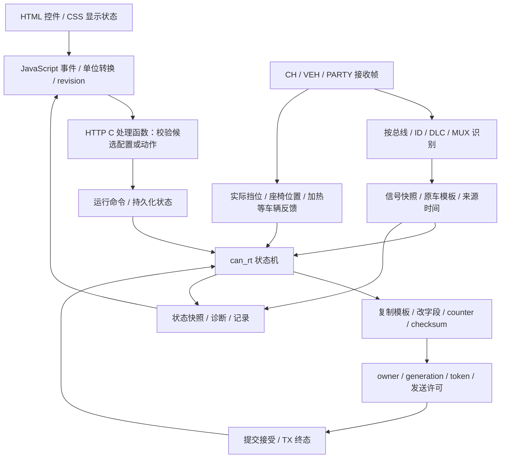

# Albert P4：网页功能与 CAN 控制逻辑

这份 Skill 独立收录网页功能、C/C++ 逻辑、CAN 控制协议和证据备注，复制整个目录即可阅读或交给其他代理使用。所有文档链接都位于本目录内，无需原分析目录、网页文件、反编译工具或联网服务。

**车辆功能主要采用“接收原车帧 → 保存信号与模板 → 状态判断 → 修改字段 → 发送 → 处理终态／车辆反馈”**。网页设置改变配置或提交动作意图，实际 CAN 处理由实时任务执行。

适用镜像：`Albert-P4-P1.6.4-V3.2-4d97f369-16MiB-bootstrap.bin`；对应 OTA 的应用内容相同。ESP-IDF 5.5.5、Arduino 3.3.7，提交 `4d97f369e1a32f126b7121a66a70a53fca628dfa`。原程序含 C++；文中 C 风格代码是逻辑重建，语义函数名由分析者命名。

## 先理解这一条链

这是语义架构图，不规定所有分支的逐指令执行顺序。CH `0x3FD MUX0` 另有 `fsd_p0` 高优先级发送路径；扭矩存在专门的来源跟随提交路径。

## 功能怎样依赖 CAN

| 功能组 | 接收／判断 | 输出／结果 |
|---|---|---|
| FSD、自动激活、预警激活 | 协议、可用状态、挡位、物理按键、预警边沿 | 修改协议模板中的请求，等待发送与状态反馈 |
| 速度补偿 | 限速、原车设速、驾驶模式、驾驶员目标表 | 计算目标，修改字段，区分 final 与 confirmed |
| 免打扰、扭矩 | 摄像头／ISA／HOS；PARTY `0x39B`、`0x370` | 状态字段覆盖、滚轮动作、扭矩模板修改 |
| 换挡、障碍物 | 车速、刹车、安全带、转角；PARTY `0x255/0x12B` | 先过共同门控再请求挡位，以实际挡位确认 |
| 座椅、驾驶员 | 位置反馈、物理请求、`0x4F3` 模板 | 手动续租／停止、记忆调用；位置匹配选择配置 |
| 氛围灯、远光、雾灯 | 开门、占用、FSD、盲区、转向、减速、倒车 | 合成区域目标或灯光请求，处理 owner 与恢复 |
| 预热、维修 | 热管理／电气反馈和运行许可 | VEH82预热启停、计时与恢复；VEH339维修开关 |
| 抓包、实验、记录、诊断 | 帧、来源模板、运行与发送事件 | 观察／导出；实验按位修改并回到选定来源线路 |
| CSS、登录、Wi-Fi、云、OTA | 浏览器与管理状态 | 显示／认证／存储／网络；OTA 与重启协调 CAN 停止 |

## 按问题阅读

- 查全部功能归属：读 [145 项功能的 CAN 对照表](references/feature-can-map.md)，每项链接本目录内的详细逻辑、JS 定位备注、HTTP/C 地址和伪代码。
- 理解实时任务、模板来源与发送确认：读 [CAN 运行与发送生命周期](references/can-runtime.md)。
- 查哪一路CAN、哪个ID、哪个字节/bit、怎样控制与数值：先读 [CAN 控制协议与数值表](references/control-protocol.md)，含座椅24方向、反馈四轴、换挡、速度、摄像头、远光/雾灯、氛围、预热和维修的字段与C伪代码。
- 查扭矩的校验、编码与其他原始观察值：读 [报文与已确认位布局](references/can-frames.md)。其中 `0x370` 给出完整字段修改伪代码。
- 看功能如何由 C 状态机实现：读 [功能状态机与伪逻辑](references/control-logic.md)。
- 查离车泊车相关实现：读 [原车泊车请求与驾驶位模拟](references/exit-parking.md)，含293/30A字段、退出窗口、两帧零车速、公开Active的TX与3A1组合判定，以及车门解析、P出发完成计数与增强AP边界。
- 查页面参数、单位与范围：读 [参数索引](references/parameters.md)；查接口与处理函数：读 [87 条 HTTP 路由](references/http-routes.md)。
- 评估结论可靠性或准备进一步复核：读 [证据备注与缺口](references/evidence.md)。

18 个详细模块已收录在 `references/features/`，从功能对照表进入即可。原 JS 行号和反编译地址改为文字定位备注；原始固件、网页、完整反编译与反汇编未附带。阅读不依赖这些原始材料，重新验证机器码时需另行取得匹配镜像。

## 使用时的操作规则

1. 从功能对照表找到对应模块，只读取相关参考文档。用模块说明和参数索引确认控件、请求字段、单位，再用路由表核对 HTTP handler；区分配置保存与一次动作。
2. 沿文档中的运行命令、解析器、状态机、模板构造、提交与终态解释逻辑。地址及原 JS 行号是分析时的定位备注，不是本包中的源码链接，也不单独证明车辆执行效果。
3. 对每个信号记录 `bus + ID + DLC + MUX + byte/bit + scale/offset + invalid + freshness`。缺项写“未确认”；同 ID 不同线路或 MUX 分开记录。
4. 写出输入、门控、状态、输出、确认、退出／失败；使用符号谓词表示尚未恢复的算法，不填入猜测位号或阈值。
5. 字段编码以控制协议表和报文公式为准；先区分payload从对象`+5`还是`+6`开始。用户提供匹配原始镜像并要求继续逆向时，再复核机器码；自动函数发现会漏入口，已知例子为`0x480C5306`和`0x4FF24BDA`。
6. 输出中文逻辑说明与 C 风格伪代码，引用本包文档、原固件地址和具体缺口。区分文档校验、原始代码复核与硬件验证；不要把定位备注称为已附源码。

## 阅读边界

本版本已整理 18 模块、145 项功能及子功能、87 条 HTTP 注册、437 行静态／模板控件。这些计数表示功能清单覆盖，不表示每个 CAN 算法都完整恢复。此次静态分析未连接设备或车辆；不能把 HTTP `ok`、提交 `accepted`、TX `terminalOk` 当作车辆功能已经执行成功。

具体编码已补充，泊车293请求与占用/安全带30A模拟字段已复核；尚未完整恢复的重点包括各协议FSD激活序列、ISA字段、原车离车泊车执行与完成反馈、速度目标计算全边界、灯效曲线、多owner全部仲裁顺序、预热实际工作确认、完整厂家维修服务及实验校验边界。以[协议缺口表](references/control-protocol.md#gaps)为准。
